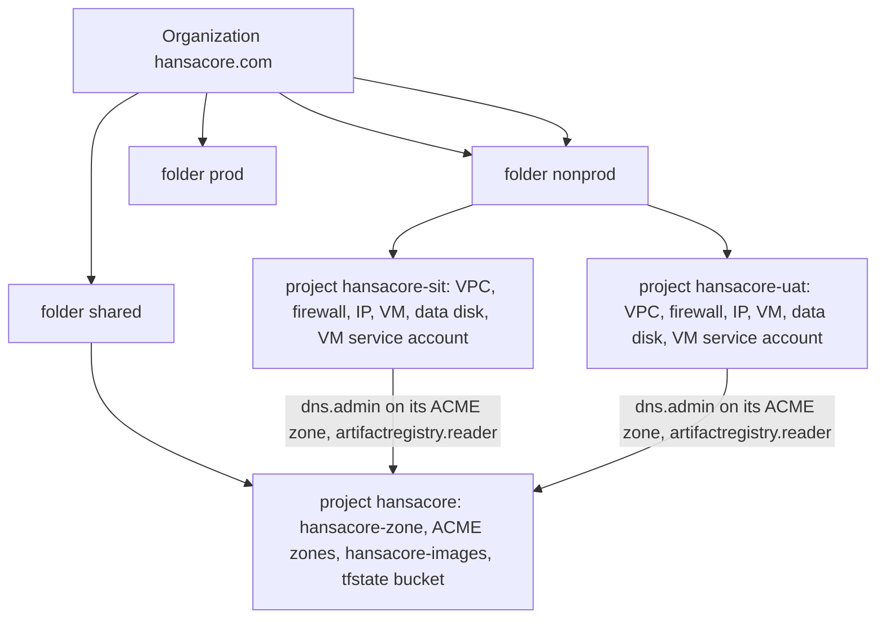

# HansaCore Deployment (`hansacore-deployment`)

Infrastructure-as-Code and Kubernetes manifests for deploying the **HansaCore** platform on a single-node **k3s Kubernetes cluster**.

The same base manifests deploy across three environments on **Hetzner Cloud**; each has its own Kustomize overlay:
1. **SIT (`overlays/sit`)**: a single **Hetzner Cloud** VM (`hansacore-sit`, `cpx22`, Nuremberg) running k3s, provisioned with **Terraform** (`infra/hetzner/`) and `scripts/manage-env.sh` (§8). System Integration Testing sandbox.
2. **UAT (`overlays/uat`)**: the same shape as SIT (`hansacore-uat`, `cpx22`) (§8).
3. **PROD (`overlays/prod`)**: the same shape on a larger VM (`hansacore-prod`, `cpx32`, 8 GB RAM, 160 GB NVMe, automatic backups enabled) (§8).

Local development runs directly via Docker Compose (`hansacore-portal/docker-compose.yml`) for Keycloak + Postgres, and your IDE / `hansacore-web/start-dev.ps1` for sub-second hot reload.

The old GCP Terraform under `infra/gcp/` is obsolete.

Deploying a change is `git pull`, optionally rebuild images, then `kubectl apply -k <overlay>`; see §5 ("Deploying changes") for the exact routine.

---

## 1. System Architecture

### Hostnames

Pattern: `<env>.<app>.hansacore.com`; production has no environment label.

| Environment | Portal | ERP (`hansacore-web`) | Keycloak |
| :--- | :--- | :--- | :--- |
| PROD | `hansacore.com` | `erp.hansacore.com` | `auth.hansacore.com` |
| UAT (Hetzner, `overlays/uat`) | `uat.hansacore.com` | `uat.erp.hansacore.com` | `uat.auth.hansacore.com` |
| SIT (Hetzner, `overlays/sit`) | `sit.hansacore.com` | `sit.erp.hansacore.com` | `sit.auth.hansacore.com` |
| Local Dev (Docker Compose + IDE) | `localhost:8080` (Gateway) | `localhost:4200` | `localhost:8082` |

One login for all app hosts: each app host has its own host-only gateway
session (`PORTAL_SESSION`), and single sign-on between them comes from
Keycloak's session on the auth host — opening the portal after logging in to
the ERP bounces through Keycloak once, without a password prompt. Future
portal sub-apps go under the portal host as subpaths.

```text
                                       Internet / Host Browser
                                                  │
                                                  ▼
                               ┌─────────────────────────────────────┐
                               │       Traefik Ingress (k3s)         │
                               │  Port 80 (HTTP, redirected) / 443   │
                               └──────────────────┬──────────────────┘
                                                  │
         ┌───────────────────┬────────────────────┼───────────────────┐
         │ ERP host: /       │ ERP + portal host: │ auth host:        │ auth host: /admin
         │ portal host: /    │ /oauth2, /logout,  │ /realms, /js,     │ (own Ingress;   
         │ (placeholder)     │ /login/oauth2,     │ /resources        │  BasicAuth: DEV)
         │                   │ /api, /be          │                   │
         ▼                   ▼                    ▼                   ▼
 ┌──────────────┐    ┌────────────────┐   ┌───────────────┐   ┌───────────────┐
 │hansacore-web │    │ portal-gateway │   │   keycloak    │   │   keycloak    │
 │portal-placeh.│    │  (Spring BFF)  │   │  (Keycloak 24)│   │ admin console │
 │   Port 80    │    │   Port 8080    │   │   Port 8080   │   └───────────────┘
 └──────────────┘    └───────┬────────┘   └───────┬───────┘
                             │                    │
                             ▼                    │
                     ┌────────────────┐           │
                     │ hansacore-api  │           │
                     │ (Spring Boot)  │           │
                     │   Port 8081    │           │
                     └───────┬────────┘           │
                             │                    │
                             └──────────┬─────────┘
                                        ▼
                              ┌──────────────────┐          ┌───────────────────┐
                              │     postgres     │          │  Microsoft Entra  │
                              │  (Postgres 16)   │          │ (Azure AD OAuth2) │
                              │    Port 5432     │          └───────────────────┘
                              └──────────────────┘
```

### Components

| Service | Technology | Port | Purpose |
| :--- | :--- | :--- | :--- |
| **`postgres`** | PostgreSQL 16 Alpine | `5432` | Dual database instance (`hansacore` and `keycloak`). StatefulSet on a `local-path` volume in every environment. Prod sets `shared_buffers=1GB` |
| **`keycloak`** | Keycloak 24.0 (`start`, not `start-dev`) | `8080` | Identity and Access Management with Microsoft Entra ID OIDC identity broker |
| **`hansacore-api`** | Spring Boot 3.4 / Java 21 | `8081` | Core trading and backoffice REST API resource server |
| **`portal-gateway`** | Spring Cloud Gateway / BFF | `8080` | Secure session gateway, OAuth2 token relay, and reverse proxy |
| **`hansacore-web`** | Angular 20 SPA / Nginx | `80` | ERP frontend, on the ERP host |
| **`portal-placeholder`** | Nginx + static page (ConfigMap) | `80` | Stand-in for the portal frontend on the portal host; shows the sign-in state |
| **`traefik`** | Traefik Ingress Controller | `80 / 443` | Reverse proxy, TLS termination, HTTPS redirect, and security headers |

All JVM services (`keycloak`, `hansacore-api`, `portal-gateway`) have a **`startupProbe`**
in base. Their cold start is slow (Keycloak's non-optimized `start` runs a ~70 s
build step; the API needs several minutes on a 2-vCPU node), and without it the
liveness probe kills them in a restart loop.

---

## 2. Repository Structure

```text
hansacore-deployment/
├── k8s/
│   ├── base/                           # Environment-agnostic manifests (no
│   │   │                               # secrets, no hardcoded hostnames/IPs)
│   │   ├── kustomization.yaml
│   │   ├── 00-namespace.yaml
│   │   ├── 01-postgres.yaml            # StatefulSet, local-path volume, Service
│   │   │                               # (init.sh reads DB passwords from env).
│   │   ├── 02-keycloak.yaml            # `start` (not `start-dev`), hostname from
│   │   │                               # hansacore-env ConfigMap, admin pw from Secret
│   │   ├── 03-hansacore-api.yaml
│   │   ├── 04-portal-gateway.yaml
│   │   ├── 05-hansacore-web.yaml
│   │   ├── 06-ingress-erp.yaml         # ERP host: SPA + gateway paths; forces HTTPS
│   │   ├── 06-ingress-portal.yaml      # portal host: placeholder + gateway paths
│   │   ├── 06-ingress-auth.yaml        # auth host: Keycloak OIDC endpoints
│   │   ├── 07-ingress-admin.yaml       # auth host /admin only, + BasicAuth middleware
│   │   │                               # (hetzner-vm removes the BasicAuth, see §6)
│   │   ├── 08-middlewares.yaml         # Traefik: HTTPS redirect, BasicAuth, HSTS,
│   │   │                               # X-Frame-Options SAMEORIGIN
│   │   ├── 09-networkpolicies.yaml     # default-deny + explicit pod-to-pod allows
│   │   ├── 10-ingress-http-redirect.yaml
│   │   └── 11-portal-placeholder.yaml  # stand-in portal page (nginx + ConfigMap)
│   ├── templates/
│   │   └── backup-cronjob.yaml         # inactive S3 dump; not part of an overlay (§8)
│   ├── components/
│   │   ├── demo-data/                  # demo tenants/users for the API (all overlays)
│   │   │   ├── kustomization.yaml          # ConfigMap generator + api mount/import
│   │   │   └── demo-data.yml               # git-ignored (real names/emails)
│   │   ├── gcp-vm/                     # legacy GCP hostPath patches; do not use
│   │   └── hetzner-vm/                 # sit + uat + prod: admin Ingress without BasicAuth
│   └── overlays/
│       ├── sit/                        # SIT: Hetzner VM (hansacore-sit)
│       │   ├── kustomization.yaml          # host patches, api profile `sit`, hetzner-vm component
│       │   ├── 04-cert-issuers.yaml        # cert-manager ClusterIssuers (LE staging + prod)
│       │   ├── 05-certificate.yaml         # one Certificate, 3 SANs -> Secret hansacore-tls
│       │   ├── hansacore-env.properties    # SIT hostnames / issuer / CORS
│       │   └── secrets/*.env.example       # templates; no custom truststore
│       ├── uat/                        # UAT: Hetzner VM (hansacore-uat), api profile `uat`
│       └── prod/                       # PROD: Hetzner VM (hansacore-prod), api profile `prod`
├── infra/                               # Terraform (§8). Hetzner is the live layout.
│   ├── shared/                         # firewall, DNS zone, private network, SSH key
│   ├── modules/server/                 # one Hetzner VM
│   ├── envs/sit|uat|prod/              # one server each
│   └── gcp/                            # unused GCP stack (projects, envs, environment module)
├── identity/
│   ├── portal-realm.template.json      # Keycloak realm export, WITH PLACEHOLDERS
│   │                                    # (__ERP_BASE_URL__, __PORTAL_BASE_URL__,
│   │                                    #  __*_CLIENT_SECRET__, __SMTP_*__, ...)
│   ├── themes/hansacore/               # HansaCore login + email theme
│   └── Dockerfile                      # Keycloak 24 + theme -> hansacore-keycloak:local
├── scripts/
│   ├── bootstrap-secrets.sh            # generates git-ignored secret files per overlay
│   ├── render-realm.sh                 # renders the realm template -> per-overlay ConfigMap
│   ├── build-images.sh                 # builds the :local images on the VM (all envs)
│   ├── apply-realm-sso-onboarding.sh   # applies the SSO onboarding realm changes to a running Keycloak
│   ├── register-customer-directory.sh  # binds an existing customer's directory + domains (e.g. Forty2)
│   ├── bootstrap-vm.sh                 # old GCP VM bootstrap (data disk, repos, cert-manager)
│   └── manage-env.sh                   # Hetzner: status, deploy, build, logs, db-shell (§8)
├── .gitignore
└── README.md
```

**Nothing in `k8s/base/` hardcodes a secret, IP, or hostname.** Everything
environment-specific lives in exactly one place per environment:
`k8s/overlays/<env>/hansacore-env.properties` (hostnames/CORS/issuer, plus
the matching Ingress host patches in that overlay's `kustomization.yaml`) and
`k8s/overlays/<env>/secrets/*.env` (passwords/client secrets, git-ignored).
That's what makes the Hetzner VMs usable from
the same base manifests.

### API profiles, truststore and demo data

The same `hansacore-api` image runs everywhere; the overlay decides how.

| Environment | Active Spring Profile | Truststore | Demo Data Component |
| :--- | :--- | :--- | :--- |
| **Local Dev** | `dev` (in IDE / local properties) | Standard JVM | Local seed |
| **SIT** | `sit` | Standard JVM (Let's Encrypt) | `components/demo-data` |
| **UAT** | `uat` | Standard JVM (Let's Encrypt) | `components/demo-data` |
| **PROD** | `prod` (Swagger off) | Standard JVM (Let's Encrypt) | None (clean DB) |

- **No hidden default profile.** `application.properties` doesn't set one, so
  the profile always comes from the overlay (or `-Dspring-boot.run.profiles=dev`
  / the IDE run configuration locally). It is patched onto the api
  Deployment only, not into `hansacore-env`, because the gateway reads that
  ConfigMap too.
- **No dev credentials in the image.** `hansacore-api/.dockerignore` keeps
  the git-ignored `application-dev.properties` (and `-local`, `-forty2`,
  `vpn_templates/`, `demo-data-local.yml`) out of the build context. In the
  cluster, datasource, issuer and CORS always come from env.
- **Seeding switch.** On a fresh database the API always creates the system
  users and roles, plus reference data (currencies, countries, DAX40). With
  `HANSACORE_DEMODATA_ENABLED=true` it also seeds the tenants/users from
  `demo-data.yml` and sample content. The first start records
  `DEMO_DATA_CREATED` either way, so **changing the switch later has no
  effect** until the `hansacore` database is recreated.
- **`demo-data.yml` is git-ignored** (real names and emails). Copy it into
  `k8s/components/demo-data/` on every machine that renders an overlay,
  otherwise `kubectl apply -k` fails.

---

## 3. Quick Start (Local Development & Remote Deployment)

### Local Development Loop (Inner Loop)
Local development runs without Kubernetes for instant sub-second hot-reloading:

1. **Start database and identity dependencies**:
   Run Docker Compose from `hansacore-portal`:
   ```bash
   cd hansacore-portal
   docker compose up -d
   ```
   This spins up:
   - PostgreSQL (`hansacore` DB on `:5432`, `keycloak` DB on `:5433`)
   - Keycloak 24 IAM on `http://localhost:8082`

2. **Launch applications**:
   - `hansacore-api`: Run via IDE or `mvnw spring-boot:run -Dspring-boot.run.profiles=dev` (`http://localhost:8081`).
   - `portal-gateway`: Run via IDE or `mvnw spring-boot:run -Dspring-boot.run.profiles=dev` (`http://localhost:8080`).
   - `hansacore-web`: Run `npx ng serve --port 4200` (`http://localhost:4200`).
   *(Alternatively, run `hansacore-web/start-dev.ps1` to launch all services in dedicated terminal windows).*

### Remote Environments (SIT, UAT, PROD)
Remote environments run on Hetzner Cloud and are managed via `scripts/manage-env.sh`:
```bash
# Check status of cluster pods, ingress, and nodes
bash scripts/manage-env.sh status sit

# Deploy all changes (pulls repos, builds images, applies overlay, restarts pods)
bash scripts/manage-env.sh deploy sit

# Build and restart a specific component
bash scripts/manage-env.sh build sit api       # api | gateway | web

# View live service logs
bash scripts/manage-env.sh logs sit api        # api | gateway | web | keycloak | postgres
```

### Rotating a secret on SIT / UAT / PROD
Delete the specific file under `k8s/overlays/<env>/secrets/`, re-run
`scripts/bootstrap-secrets.sh <env>` (only regenerates what's missing),
then `scripts/render-realm.sh <env>` and `kubectl apply -k k8s/overlays/<env>`.

---

## 4. Microsoft Entra ID (Azure AD) SSO Integration

Azure AD strictly enforces that all non-localhost redirect URIs must begin with `https://`.

### Who owns the Microsoft login
The platform's Microsoft login is one **app registration** that must live in a
directory **HansaCore owns**, not in a customer's (Forty2's) directory, or the
customer's admins control sign-in for everyone. The HansaCore directory holds
no users of the platform and no Azure subscription, only this registration.
`docs/sit-sso-rollout.md` §1 creates it. The legacy registration
(`74741127-2028-4328-a8cf-057363b92b42`, in Forty2's directory) is only the
fallback while `MICROSOFT_CLIENT_ID` is unset in an overlay's
`keycloak-clients.env`; remove it once every environment has switched.

### Azure Portal Configuration
1. Go to [Microsoft Entra Admin Center](https://entra.microsoft.com/) in the HansaCore directory $\rightarrow$ **App registrations**.
2. Select the HansaCore app registration (its Application ID is `MICROSOFT_CLIENT_ID`).
3. Under **Authentication** $\rightarrow$ **Redirect URIs**, add one per environment's auth host:
   ```text
   https://dev.auth.hansacore.com/realms/portal/broker/microsoft/endpoint
   https://sit.auth.hansacore.com/realms/portal/broker/microsoft/endpoint
   https://uat.auth.hansacore.com/realms/portal/broker/microsoft/endpoint
   ```
   The DEV name does not need to be publicly resolvable — the redirect happens in the browser.

### Entra Client Secret
Under **Certificates & secrets** → **New client secret**, create a secret and copy its
**Value** (not the Secret ID) into the overlay's git-ignored secrets file. Use a
**separate secret per environment** (description e.g. `hansacore-uat`), so one
environment's secret can be revoked without breaking the others:
```text
k8s/overlays/<env>/secrets/keycloak-clients.env  →  MICROSOFT_CLIENT_ID=<application (client) ID>
                                                    MICROSOFT_CLIENT_SECRET=<value>
```
Then re-render (`scripts/render-realm.sh <env>`). Note: realm import runs once on an
empty database, so re-rendering only covers fresh installs. For a running cluster,
`scripts/apply-realm-sso-onboarding.sh <env>` copies both values into the live
`microsoft` identity provider (or reset the keycloak database per §6 to force a
re-import).

### Multi-tenant sign-in (other companies)
Users from any Microsoft work directory can sign in. HansaCore recognises an
organisation by the directory ID (`tid`) and by email domains Microsoft has
verified (`xms_edov`), so the app registration must emit both:

1. **Authentication** → *Supported account types*: **Accounts in any
   organizational directory (multitenant)**. Personal Microsoft accounts stay
   excluded; the realm uses the `/organizations/` endpoints.
2. **Token configuration** → *Add optional claim* → **ID** token: `email`,
   `xms_edov`, `given_name`, `family_name`. (`tid` is always in v2 tokens; the
   names avoid the "update your profile" prompt on first login.)
3. **Manifest** → `"authenticationBehaviors": { "removeUnverifiedEmailClaim": true }`,
   so Microsoft drops `email` claims whose domain the directory has not verified.
4. Keep the delegated permissions at `openid`, `profile`, `email`. Customers
   whose directory blocks user consent need their admin to consent once:
   `https://login.microsoftonline.com/organizations/adminconsent?client_id=<MICROSOFT_CLIENT_ID>`

The Keycloak side (organizations endpoints, no fixed issuer, the `idp_*`
attribute mappers, `identity_provider` token claim, no auto-linking by email,
self-registration with email verification, SMTP, HansaCore theme) is in the
realm template. For a running cluster apply it with:
```bash
bash scripts/build-images.sh keycloak && kubectl rollout restart deploy/keycloak -n hansacore
bash scripts/apply-realm-sso-onboarding.sh <env>
```
SMTP settings live in `k8s/overlays/<env>/secrets/keycloak-smtp.env`
(`scripts/bootstrap-secrets.sh` creates a placeholder). Without a working
relay, local accounts cannot verify their email and finish registration.

The ordered rollout for SIT (Entra, SMTP, images, schema check, apply script,
registering Forty2, smoke tests) is in [`docs/sit-sso-rollout.md`](docs/sit-sso-rollout.md).

### Provider-neutral token contract (adding Google, AWS, ...)
The API does not read Microsoft claims. Every identity provider is mapped by
Keycloak onto the same access-token claims, and the API decides per provider
how far to trust them:

| Claim | Meaning | Microsoft source |
|-------|---------|------------------|
| `identity_provider` | Keycloak identity provider alias (absent for local accounts) | session note |
| `idp_directory_id` | the customer's directory at the provider | `tid` |
| `idp_email` | the email as the provider sent it | `email` |
| `idp_domain_verified` | the provider vouches for the email's domain | `xms_edov` |

A customer is recognised by `(provider key, directory id)` bound to its
MASTER_CLIENT, or by a verified domain plus a trusted email. The binding key
for Microsoft is the fixed value `MICROSOFT`. An alias with no trust policy is
trusted with nothing: such a person is turned away at first sign-in, so adding
a Keycloak identity provider cannot open the platform before its policy exists.

To add a provider (for example Google Workspace), later and not yet needed:
1. Keycloak: add the identity provider and three attribute mappers onto
   `idp_directory_id` (`hd`), `idp_email` (`email`) and `idp_domain_verified`
   (`email_verified`); the existing gateway mappers already emit them.
2. API: one class implementing `IdentityTrustPolicy` (trust rules, what counts as
   an organisation directory), registered in `IdentityTrustPolicies`.
3. Keycloak lists the new provider on its login page by itself; adjust the wording
   in `hansacore-web` `login.component.html` and the theme if you want it named.

### Registering an existing customer (Forty2)
Customers created before SSO onboarding existed have no directory binding and no
verified domain, because the onboarding schema only creates empty tables. Until
they are registered, their colleagues are not recognised on first sign-in and a
person from their directory could claim the directory and domain at `/onboarding`.
Register each such customer once, **before opening sign-in to other companies**:
```bash
bash scripts/register-customer-directory.sh <env> "<customer name>" <directory-id> <domain> [<domain>...]
# Forty2 (a customer of HansaCore that uses Microsoft Entra):
bash scripts/register-customer-directory.sh sit "Forty2" <entra-directory-id> forty2.ch
```
`<directory-id>` is the customer's Entra tenant ID (Entra admin center →
Overview → *Tenant ID*). The script binds it to the customer's MASTER_CLIENT and
registers the domains as verified (first = primary). It runs in one
transaction, can be repeated, and refuses a directory or domain that already
belongs to another customer, personal Microsoft accounts, free-mail domains and
reserved domains.

On DEV and SIT the demo data registers Forty2 itself (`idp-directory` and
`domains` of the `FORTY2` tenant in the demo-data YAML), so the script is only
needed for UAT and PROD.

### HansaCore accounts
HansaCore staff belong to the global operator tenant (`ETenant.MASTER`). The API
creates their users and roles on every start from
`hansacore-api/src/main/resources/platform-accounts.yml`; a role changed there
is applied at the next start, and a user removed from it loses its platform role.
There are three access levels:

| Level | Role | Can change |
| :--- | :--- | :--- |
| Investigation | none (every other global user) | nothing, read-only |
| Operator | `ROLE.PLATFORM_OPERATOR` | shared reference data (PUBLIC tenant) and every customer's tenant administration; customer data is read-only |
| God | `ROLE.PLATFORM_GOD` | everything |

Current accounts (identical on DEV and SIT, which share one Keycloak):
- `daniel.methner@danielmethneroutlook.onmicrosoft.com`, operator. Signs in with
  **Microsoft** through HansaCore's own Entra directory (tenant
  `3d1546c1-dba0-477e-b1e4-e8c9a004e395`, also home of the `HansaCore Login` app),
  which enforces Authenticator MFA. In Entra the user needs its *Email* field set
  (Users → user → *Properties* → *Contact information*), otherwise Microsoft sends
  no email and the sign-in is refused. `hansacore.com` cannot be added to this
  directory: it is verified in an older Microsoft directory (tenant
  `113c7d0f-04fa-46f8-884c-37fadc7fd433`, account `daniel.methner@hansacore.com`)
  that cannot be signed in to since its MFA device was lost. Moving the domain
  needs Microsoft support (admin recovery with DNS proof) or that access back.
- `daniel.methner.admin@hansacore.com`, god. A local Keycloak user (password and
  one-time code, seeded by `identity/portal-realm.template.json`). Create further
  local accounts in the Keycloak admin console (Users → *Add user*) with **Email
  verified** on, a temporary password and the required action *Configure OTP*.

To add a person: add an entry to `platform-accounts.yml` and give them a Microsoft
account in HansaCore's Entra (operator) or a local Keycloak user (god).
- The email domain `hansacore.com` is reserved (`hansacore.onboarding.reserved-domains`,
  comma list, default `hansacore.com`): no customer can register it, be matched
  by it, or claim it at `/onboarding`.
- System users (`technical_user@`, `intf_watsonx@`, `public_user@`, `investigation@`)
  are never signed in by a person and have no Keycloak account.

### Sign-in audit log
Who signed in, when and with what outcome is in two places, both plain log lines:
- **Keycloak** (`kubectl -n hansacore logs deploy/keycloak | grep type=`): every `LOGIN`,
  `LOGOUT`, `LOGIN_ERROR`, `REGISTER`, `IDENTITY_PROVIDER_LOGIN` and password or one-time-code
  change, with user, client, IP address and the identity provider used. Enabled in the realm
  (`eventsEnabled`, 30 days also visible under *Events* in the admin console) and by
  `KC_SPI_EVENTS_LISTENER_JBOSS_LOGGING_SUCCESS_LEVEL=info` in `k8s/base/02-keycloak.yaml`.
  Running realms get it from `scripts/apply-realm-sso-onboarding.sh`.
- **API** (`kubectl -n hansacore logs deploy/hansacore-api | grep -E 'Session resolved|Sign-in rejected|Linking identity|no selectable tenant'`):
  `Session resolved` says where each person landed (ACTIVE, ONBOARDING or PENDING_APPROVAL)
  and why, together with the trust facts that decided it (provider, directory, whether the
  email is verified and vouched for). `Sign-in rejected` and `has no selectable tenant`
  explain the pages people get stuck on. No tokens are logged.

### Demo users (DEV and SIT only)
The Forty2 demo users are the real Forty2 Microsoft accounts from `Data/UsersDEV.csv`
(an Entra export), so Forty2 staff sign in with Microsoft and land in their own
country company. After a new export, regenerate the users in the demo-data YAML and
copy the file to the server (§8):
```powershell
.\scripts\demo-users-from-csv.ps1 -Csv ..\Data\UsersDEV.csv -Yaml ..\hansacore-api\demo-data-local.yml
```
Demo data is loaded only into an empty database. To compare two environments run
`scripts/check-user-setup.sql` on both (`psql -U postgres -d hansacore -f ...`);
an equal `user_setup_fingerprint` means the same users, home tenants and roles.

### Local Windows Trust (Green Padlock)
To trust the local Certificate Authority on your Windows host:
```powershell
Import-Certificate -FilePath "ssl\ca.crt" -CertStoreLocation "Cert:\CurrentUser\Root"
```

---

## 5. GCP (SIT and UAT) — shut down

The GCP project is shut down. SIT, UAT, and prod run on Hetzner (§8). This section is the old runbook.

SIT and UAT each ran on a dedicated Compute Engine VM running k3s, provisioned
via Terraform (`infra/`). `k8s/overlays/sit` carries SIT hostnames
(`sit.hansacore.com`, `sit.erp.hansacore.com`, `sit.auth.hansacore.com`), and
`k8s/overlays/uat` carries UAT hostnames (`uat.*`).

The deploy and stop/start routines below apply to both environments; simply swap
the project name (`hansacore-sit` vs `hansacore-uat`), VM name (`hansacore-sit-vm` vs
`hansacore-uat-vm`), and overlay (`sit` vs `uat`).

### How it is set up

| Piece | Setup |
| :--- | :--- |
| VM | `hansacore-sit-vm` (in `hansacore-sit`) / `hansacore-uat-vm` (in `hansacore-uat`), `e2-standard-2`, zone `europe-west6-a` (Zurich), Ubuntu, Docker + k3s |
| Network | Dedicated VPC per project, static external IP; firewall allows only 80/443 from the internet, SSH only via **IAP** |
| Storage | Separate pd-ssd data disk (`auto-delete=no`) mounted at `/mnt/disks/postgres-data` (fstab, by UUID, `nofail`); Postgres uses it via a `hostPath` patch (`k8s/components/gcp-vm`) |
| Repos | The four repos are cloned side by side under `~/hansacore/` (`hansacore-api`, `hansacore-web`, `hansacore-portal`, `hansacore-deployment`); read-only fine-grained GitHub token |
| Images | Built on the VM (`scripts/build-images.sh`) and imported into k3s' containerd as `:local`; nothing is pushed to a registry yet |
| DNS | Hostnames point at the static IP. ACME challenges are delegated (CNAME) into a dedicated Cloud DNS zone (`hansacore-sit-acme-zone` or `hansacore-uat-acme-zone` in hub project `hansacore`) |
| TLS | cert-manager + Let's Encrypt (DNS-01). The `ClusterIssuer` uses the VM's service account through the metadata server, so no key files exist |
| IAM | The VM's service account has `roles/dns.admin` **only on its ACME zone** in the `hansacore` hub project and reader access to the Artifact Registry repo |

`kubectl` on the VM needs `export KUBECONFIG=~/.kube/config` (k3s' default
config file is root-only); this is set in `~/.bashrc`.

### First-time setup

1. Provision the project, VM, disks, firewall, service account, and DNS records
   via Terraform (§7).
2. On the VM: run `bootstrap-vm.sh` to configure swap, install Docker and k3s,
   format and mount the data disk, and clone the repos under `~/hansacore/`.
3. `scripts/bootstrap-secrets.sh sit` (or `uat`) (generates a **separate** set of
   secrets; never reuse across environments). **Save the printed BasicAuth
   password.** The Keycloak admin password is in
   `k8s/overlays/<env>/secrets/keycloak-admin.env`.
4. Put the real `MICROSOFT_CLIENT_SECRET` into
   `secrets/keycloak-clients.env`, then `scripts/render-realm.sh <env>`.
5. Copy `demo-data.yml` into `k8s/components/demo-data/` (it is git-ignored;
   e.g. `gcloud compute scp --tunnel-through-iap`), and decide
   `HANSACORE_DEMODATA_ENABLED` before the first start.
6. cert-manager is installed by `bootstrap-vm.sh` (or install manually).
7. `bash scripts/build-images.sh` (builds and imports api, gateway, web, and keycloak).
8. Add the environment broker redirect URI in Entra (§4).
9. `kubectl apply -k k8s/overlays/<env>`, then wait: a cold start takes
   about 5-10 minutes (see §6).

### Deploying changes

`git pull` alone changes nothing in the cluster: the running Deployments only
change when you **apply the manifests** (and, for code changes, rebuild the image).

```powershell
# 1. On your machine: push your changes to GitHub (each repo you touched).

# 2. Open a shell on the VM (SSH goes through IAP):
gcloud compute ssh hansacore-sit-vm --project=hansacore-sit --zone=europe-west6-a --tunnel-through-iap
# For UAT: gcloud compute ssh hansacore-uat-vm --project=hansacore-uat --zone=europe-west6-a --tunnel-through-iap
```

```bash
# 3. Pull every repo you changed (all four live side by side):
cd ~/hansacore/hansacore-deployment && git pull      # repeat in the other repos

# 4. Code changed in api / portal gateway / web? Rebuild those images:
bash scripts/build-images.sh api            # or: gateway | web | keycloak | (no args = all)

# 5. Realm template or hostnames/secrets changed? Re-render the realm ConfigMap:
scripts/render-realm.sh sit                 # or: uat

# 6. Apply the manifests (after EVERY pull of hansacore-deployment):
kubectl apply -k k8s/overlays/sit           # or: uat

# 7. Rebuilt an image? The tag stays `:local`, so apply sees no change.
#    Restart the affected Deployment to pick up the new image:
kubectl rollout restart deploy/hansacore-api -n hansacore    # or portal-gateway / hansacore-web

# 8. Watch it come up and check the endpoints:
kubectl get pods -n hansacore -w
curl -s https://sit.auth.hansacore.com/realms/portal/.well-known/openid-configuration | head -c 100; echo
curl -sI https://sit.hansacore.com | head -3
```

Notes:
- Only manifest changes: steps 3, 6, 8. Only app code: steps 3, 4, 7, 8.
- A rolling update briefly runs two copies of a service on the small node.
  The old one is removed as soon as the new one is Ready.
- `kubectl apply -k` never deletes objects that were removed from `base`;
  delete those by hand (`kubectl delete ...`).
- The realm import only runs on an empty Keycloak database (§6).

### Stopping and starting the VM

Stopping SIT or UAT when it is not in use saves compute cost (roughly $64 a
month running per VM); disks and the static IP keep costing a little. Everything
(k3s, data disk, pods, certificate) comes back by itself, about 5-6 minutes
after the VM is up.

```powershell
gcloud compute instances stop  hansacore-sit-vm --project=hansacore-sit --zone=europe-west6-a
gcloud compute instances start hansacore-sit-vm --project=hansacore-sit --zone=europe-west6-a
```

Check afterwards that the Postgres data disk is mounted
(`findmnt /mnt/disks/postgres-data`). It is mounted with `nofail`, so a
failed mount would not stop the boot, and Postgres would silently start on an
empty directory.

---

## 6. Maintenance & Troubleshooting

### Reset Keycloak Database & Re-import Realm
If `identity/portal-realm.template.json` is updated (shown for SIT; use `uat` or `prod` for other environments):
```bash
# 1. Re-render the ConfigMap for your overlay
scripts/render-realm.sh sit

# 2. Reset keycloak database in postgres
kubectl exec -n hansacore sts/postgres -- psql -U postgres -c "SELECT pg_terminate_backend(pid) FROM pg_stat_activity WHERE datname = 'keycloak' AND pid <> pg_backend_pid();"
kubectl exec -n hansacore sts/postgres -- psql -U postgres -c "DROP DATABASE IF EXISTS keycloak;"
kubectl exec -n hansacore sts/postgres -- psql -U postgres -c "CREATE DATABASE keycloak OWNER keycloak;"

# 3. Re-apply and restart
kubectl apply -k k8s/overlays/sit
kubectl rollout restart deploy/keycloak -n hansacore
```

### Checking Health & Logs
```bash
# Gateway health (actuator is not exposed on the public ingress)
kubectl exec -n hansacore deploy/portal-gateway -- wget -qO- http://localhost:8080/actuator/health

# Keycloak OIDC Discovery (SIT has a trusted Let's Encrypt certificate)
curl https://sit.auth.hansacore.com/realms/portal/.well-known/openid-configuration

# Service logs (-f follows; --previous shows the container before the last restart)
kubectl logs -n hansacore deploy/portal-gateway --tail=50 -f
kubectl logs -n hansacore deploy/hansacore-api --tail=50 -f
kubectl logs -n hansacore deploy/keycloak --previous

# Why is a pod restarting? Read the Events at the bottom
kubectl describe pod -n hansacore -l app=keycloak
```

### Troubleshooting (lessons learned on SIT)

| Symptom | Cause / fix |
| :--- | :--- |
| Traefik answers `no available server` | The route exists but the Service has no ready endpoint, i.e. the pod is not Ready. Check `kubectl get pods` and the pod's events. |
| Keycloak, API or gateway restart in a loop on first boot | The liveness probe killed a slow start. Keep the `startupProbe` (base manifests). A wrong probe **path or port** looks the same: check `kubectl describe pod` for `Startup probe failed`, and that the probe matches the service (API `8081`, gateway `8080`, `/actuator/health`; Keycloak `8080`, `/health/ready`). |
| `portal-gateway` crashes with `ReactiveOAuth2ClientConfiguration ... Constructor threw exception` | It could not fetch the OIDC configuration from `KEYCLOAK_ISSUER_URI` at startup. Keycloak is not ready yet, or the public DNS/TLS for the auth host is wrong. It restarts until Keycloak is up; that is expected on a cold boot. |
| A new image is built but nothing changes | The tag is always `:local`, so `kubectl apply` sees no diff. Run `kubectl rollout restart deploy/<name> -n hansacore`. |
| cert-manager challenge fails with `Invalid value for ... _acme-challenge` | The ClusterIssuer needs `cnameStrategy: Follow` (the ACME names are CNAMEs into the delegated zone) and `hostedZoneName` (the service account cannot list zones). Delete the failed `CertificateRequest` to retry with new settings. |
| Keycloak admin console stuck on "Loading the Admin UI" | Traefik's `frameDeny` sent `X-Frame-Options: DENY`, which blocks the console's own same-origin iframe. The middleware uses `customFrameOptionsValue: SAMEORIGIN`. |
| Keycloak gets OOMKilled (exit code 137) during startup | Keycloak 24's Quarkus augmentation and realm import require at least 1024Mi memory request and 2048Mi limit (configured in `k8s/base/02-keycloak.yaml`). |
| Pods restart 1-5 times on a cold boot | On a 2-vCPU machine, CPU contention during initial JVM startup and realm import can cause startup probe delays or transient dependency timeouts (e.g. `portal-gateway` waiting for Keycloak to serve discovery metadata). This is normal; pods recover automatically once upstream services report ready. |
| Postgres comes back empty after a VM restart | On the old GCP VM, the data disk was not mounted (`nofail`) and Postgres started on the boot disk. Check `findmnt /mnt/disks/postgres-data`, fix the mount, then restart the postgres pod. On Hetzner the data is the StatefulSet volume `postgres-storage-postgres-0` on the server's local disk (`/var/lib/rancher/k3s/storage`). That disk is deleted with the server. |

### Changing hostnames on a running cluster
The realm import only runs on an empty Keycloak database, so after changing
hostnames also update the live `portal-gateway` client (redirect URIs, web
origins, `post.logout.redirect.uris`) with `kcadm.sh` inside the Keycloak pod,
and delete Ingress objects that no longer exist in `k8s/base` —
`kubectl apply -k` does not remove them.

### Security notes
The `hansacore-api` image no longer contains dev credentials (§2), and TLS on
SIT comes from cert-manager with a service account that can edit only the ACME
DNS zone.

Still outstanding:
- Git history scrubbing (and rotation) for the secrets that were previously committed.
- **SIT and UAT: the Keycloak admin console is reachable from the internet**, protected
  only by the admin password (turn on brute-force detection in the `master`
  realm). Before a production environment exists, move it to a private route
  (separate admin hostname behind an IAP tunnel or VPN).
- The fine-grained GitHub token on the SIT and UAT VMs expires; renew it before then.

### Not done yet (SIT, UAT)
- **Backups**: no Postgres dump/restore job. SIT and UAT hold demo data only;
  needed before anything worth keeping lives there.
- **CI/CD**: deployments are manual (§5). Planned: GitHub Actions with
  Workload Identity Federation and a narrow CI service account, pushing
  images to the Artifact Registry repo (`hansacore-images`, one shared repo
  for all environments).
- **Startup ordering**: all pods start at once; Keycloak's dependents restart
  a few times on a cold boot. Init containers waiting for Keycloak/Postgres
  are an option if this gets noisy.

---

## 7. Infrastructure (Terraform) — SIT and UAT

### Resource hierarchy

One project per environment, under an Organization on `hansacore.com`
(Cloud Identity Free). Resources every environment uses live in the shared
project `hansacore`.



### Layout and state

| Directory | What | Lifetime |
| :--- | :--- | :--- |
| `infra/gcp/modules/environment/` | One environment: VPC + subnet, firewall (80/443, SSH from IAP only), static IP, pd-ssd data disk, VM (OS Login, shielded), VM service account and its IAM, A records, ACME zone + NS delegation + `_acme-challenge` CNAMEs | reused per env |
| `infra/gcp/projects/sit/`, `infra/gcp/projects/uat/` | Dedicated project (`hansacore-sit`, `hansacore-uat`) in folder `nonprod`, APIs, monthly budget (50/90/100%), optional external-IP org policy override | long-lived (`deletion_policy = PREVENT`) |
| `infra/gcp/envs/sit/`, `infra/gcp/envs/uat/` | Calls the module with the environment values | disposable: `terraform destroy` removes the environment, the project stays |

The two layers are separate because a deleted project ID stays reserved
for 30 days, so destroying and recreating an environment must not touch the
project.

State lives in `gs://hansacore-tfstate` (versioned), one prefix per root
(`projects/sit`, `envs/sit`, `projects/uat`, `envs/uat`); never on a laptop or in Git.
`.terraform.lock.hcl` is committed so every run uses the same provider version.

Everyday commands, run from the root directory (`infra/gcp/projects/uat` or `infra/gcp/envs/uat`):

```powershell
terraform init                 # once per checkout; downloads the provider, connects the state bucket
terraform fmt -recursive ..\.. # formatting
terraform validate
terraform plan -out=tfplan     # READ this: what will be created, changed, destroyed
terraform apply tfplan
terraform output               # e.g. external_ip, ssh_command
terraform destroy              # envs/uat only
```

### Runbook: first-time UAT setup

All commands run in PowerShell on your machine unless stated otherwise.

**1. Organization (Cloud Identity Free)**

1. In the Cloud console, go to **IAM & Admin → Identity & Organization**. The console now guides you to the **Google Cloud setup checklist**.
2. Click **Go to checklist** (or **Choose an option** under "Support your workloads") and select an option like **Proof of concept** or **Production**.
3. Follow the **Organisation resource** step in the checklist:
   - When prompted, sign up with your domain `hansacore.com` and create the super admin `gcp-admin@hansacore.com` (this provisions Cloud Identity Free behind the scenes).
   - Verify the domain with the TXT value the wizard shows. If `hansacore.com` already has a TXT record (e.g. SPF) in the `hansacore` project, add the new verification string to the existing TXT record via the Cloud Console, or use `gcloud`. Example for creating a new record:
     ```powershell
     gcloud dns record-sets create hansacore.com. --zone=hansacore-zone --project=hansacore --type=TXT --ttl=300 --rrdatas='"google-site-verification=VALUE"'
     ```
   - Once verified, sign in to the Google Cloud console as `gcp-admin@hansacore.com` and accept the agreement. This creates the Organization.
4. Complete the initial IAM setup. Authenticate as the new super admin:
   ```powershell
   gcloud auth login gcp-admin@hansacore.com
   gcloud organizations list                     # note ORG_ID
   ```
   Grant the required roles to the super admin so Terraform can build the infrastructure:
   ```powershell
   gcloud organizations add-iam-policy-binding ORG_ID --member=user:gcp-admin@hansacore.com --role=roles/resourcemanager.organizationAdmin
   gcloud organizations add-iam-policy-binding ORG_ID --member=user:gcp-admin@hansacore.com --role=roles/resourcemanager.folderAdmin
   gcloud organizations add-iam-policy-binding ORG_ID --member=user:gcp-admin@hansacore.com --role=roles/resourcemanager.projectCreator
   gcloud organizations add-iam-policy-binding ORG_ID --member=user:gcp-admin@hansacore.com --role=roles/orgpolicy.policyAdmin
   ```
   *(If a binding fails with permission denied, add it manually on the organization's **IAM** page in the console as the super admin.)*
5. **Billing**: The billing account likely still belongs to your personal Gmail account. Grant the new admin access to it (budgets need Billing Account Administrator):
   ```powershell
   gcloud billing accounts list --account=danielmethnerek@gmail.com          # note BILLING_ID
   gcloud billing accounts add-iam-policy-binding BILLING_ID --member=user:gcp-admin@hansacore.com --role=roles/billing.admin --account=danielmethnerek@gmail.com
   ```
6. Check the enforced org policies:
   ```powershell
   gcloud org-policies list --organization=ORG_ID
   ```
   - `iam.allowedPolicyMemberDomains`: new IAM grants to non-`hansacore.com`
     accounts (your Gmail) might be blocked. Work as `gcp-admin@hansacore.com` from now on.
   - `compute.vmExternalIpAccess`: if listed, set `allow_vm_external_ip = true`
     in `infra/gcp/projects/uat/terraform.tfvars`, otherwise the VM can't get its public IP.
   - `compute.requireOsLogin`: UAT uses OS Login anyway.
7. Folders:
   ```powershell
   gcloud resource-manager folders create --display-name=shared  --organization=ORG_ID
   gcloud resource-manager folders create --display-name=nonprod --organization=ORG_ID
   gcloud resource-manager folders create --display-name=prod    --organization=ORG_ID
   gcloud resource-manager folders list --organization=ORG_ID    # note the IDs
   ```
8. Move the existing project into `shared`. It still belongs to your Gmail
   account, so first grant the domain admin the Project Mover and Project IAM Admin roles (assigning Owner fails via CLI due to SOLO_MUST_INVITE_OWNERS). This is done as the Gmail account, and then the move is performed as the new domain admin:
   ```powershell
   gcloud projects add-iam-policy-binding hansacore --member=user:gcp-admin@hansacore.com --role=roles/resourcemanager.projectMover --account=danielmethnerek@gmail.com
   gcloud projects add-iam-policy-binding hansacore --member=user:gcp-admin@hansacore.com --role=roles/resourcemanager.projectIamAdmin --account=danielmethnerek@gmail.com
   gcloud beta projects move hansacore --folder=SHARED_FOLDER_ID
   ```
   From this moment the org policies apply to SIT. Start the SIT VM and run
   the checks from §5 (pods, both `curl`s, a browser login).

**2. DNS pre-check**

```powershell
gcloud dns record-sets list --zone=hansacore-zone --project=hansacore --filter="name~uat"
```

Leftover `uat.*` records (e.g. from DigitalOcean) make `terraform apply` fail;
delete them, e.g.
`gcloud dns record-sets delete uat.hansacore.com. --type=A --zone=hansacore-zone --project=hansacore`.
Terraform creates `_acme-challenge.<host>` → `<label>.acme-uat.hansacore.com.`
(e.g. `uat-erp`); SIT's hand-made CNAMEs may use other targets, which doesn't
matter, as long as the target is inside the environment's ACME zone.

**3. Terraform foundations**

```powershell
winget install Hashicorp.Terraform       # new terminal afterwards; check: terraform -version
gcloud auth application-default login    # as gcp-admin@hansacore.com
gcloud auth application-default set-quota-project hansacore
gcloud services enable billingbudgets.googleapis.com cloudbilling.googleapis.com cloudresourcemanager.googleapis.com orgpolicy.googleapis.com --project=hansacore
gcloud storage buckets create gs://hansacore-tfstate --project=hansacore --location=europe-west6 --uniform-bucket-level-access --public-access-prevention
gcloud storage buckets update gs://hansacore-tfstate --versioning
```

Bucket names are global. If `hansacore-tfstate` is taken, pick another and
change `bucket` in both `versions.tf` backend blocks. The same applies to the
project ID `hansacore-uat` (`project_id` in both roots).

**4. Terraform apply**

1. Fill `folder_id` (nonprod) and `billing_account` in
   `infra/gcp/projects/uat/terraform.tfvars`, then:
   ```powershell
   cd infra\gcp\projects\uat
   terraform init; terraform validate; terraform plan -out=tfplan
   terraform apply tfplan
   ```
2. The environment:
   ```powershell
   cd ..\..\envs\uat
   terraform init; terraform validate; terraform plan -out=tfplan
   terraform apply tfplan
   terraform output
   ```
3. Commit both `.terraform.lock.hcl` files and the filled `terraform.tfvars`.
4. Check: `nslookup uat.auth.hansacore.com` returns `external_ip`, and
   `nslookup -type=NS acme-uat.hansacore.com` returns Google name servers.

**5. Bootstrap the VM**

The repos aren't on the new VM yet, so copy the script over (from the
`hansacore-deployment` directory):

```powershell
gcloud compute scp scripts/bootstrap-vm.sh hansacore-uat-vm:/home/gcp_admin_hansacore_com/bootstrap-vm.sh --project=hansacore-uat --zone=europe-west6-a --tunnel-through-iap
gcloud compute ssh hansacore-uat-vm --project=hansacore-uat --zone=europe-west6-a --tunnel-through-iap
```

On the VM:

```bash
sed -i 's/\r$//' ~/bootstrap-vm.sh   # in case the copy has Windows line endings
bash ~/bootstrap-vm.sh               # asks for GitHub username + token on the first clone
source ~/.bashrc
```

With OS Login your VM username is derived from your account email
(`gcp_admin_hansacore_com`, underscores replacing hyphens and dots), so the home directory is `/home/gcp_admin_hansacore_com`.
*(Note: in PowerShell on Windows, pass the explicit remote path `/home/gcp_admin_hansacore_com/...` to `gcloud compute scp`, as `~` may be interpreted literally).*

**6. Entra**

Add the UAT redirect URI and create a UAT-only client secret (§4).

**7. Deploy**

Push the `hansacore-api` commit with `application-uat.properties` first
(the API image must contain the `uat` profile). Then from Windows, copy the
git-ignored demo data:

```powershell
gcloud compute scp k8s/components/demo-data/demo-data.yml hansacore-uat-vm:/home/gcp_admin_hansacore_com/hansacore/hansacore-deployment/k8s/components/demo-data/demo-data.yml --project=hansacore-uat --zone=europe-west6-a --tunnel-through-iap
```

On the VM:

```bash
cd ~/hansacore/hansacore-deployment
scripts/bootstrap-secrets.sh uat
nano k8s/overlays/uat/secrets/keycloak-clients.env   # MICROSOFT_CLIENT_SECRET=<UAT secret value>
scripts/render-realm.sh uat
bash scripts/build-images.sh
kubectl apply -k k8s/overlays/uat
kubectl get pods -n hansacore -w                     # 5-10 minutes on a cold start
```

Verify as for SIT: `kubectl get certificate -n hansacore` shows `READY True`,
both `curl` checks from §5 (with `uat.*`), a browser login including
Microsoft, the admin console loads (turn on brute-force detection in the
`master` realm), and a VM stop/start.

**8. Prove repeatability**

```powershell
cd infra\gcp\envs\uat
terraform destroy          # VM, disks, IP, DNS records, ACME zone; the project stays
terraform apply            # new VM and IP; Terraform updates the A records
```

Then repeat steps 5 and 7, and time the whole run. Keep the UAT Entra
secret in your password manager so step 7 doesn't need a new one. Notes:
- The new VM has a new SSH host key, so PuTTY warns once; that is expected.
- Let's Encrypt production allows only **5 certificates per week for the
  same set of names**. For repeated destroy/recreate tests, point
  `05-certificate.yaml` at `letsencrypt-staging` first.
- For a long idle period, `terraform destroy` costs nothing; stopping the VM
  still costs the disks and the static IP.

### Adding another environment (e.g. PROD)

Prod is already defined for Hetzner in §8. The steps below are the old GCP copy procedure.

Copy `infra/gcp/projects/uat` and `infra/gcp/envs/uat` (change `project_id`,
`folder_id`, `env`, `subnet_cidr`, `hostnames`, the backend `prefix`, and
`vm_name`), copy `k8s/overlays/uat` with the new hostnames, and add
`application-<env>.properties` in `hansacore-api`.

---

## 8. Hetzner Cloud (SIT, UAT, PROD)

Three single-node k3s VMs in one Cloud project `hansacore`, location `nbg1` (Nuremberg). Postgres stays on the server's local NVMe via the k3s `local-path` provisioner. That disk is persistent across reboots, but deleted when the server is destroyed. Prod turns on Hetzner automatic backups for that reason. `k8s/templates/backup-cronjob.yaml` is an inactive off-site dump template (suspended, and not part of any overlay).

### Server Types in Nuremberg (`nbg1`)

The older `cx33`/`cx43` types are currently out of capacity (`Available: no`) in European datacenters. We use the active compute-optimized AMD EPYC line (**`cpx`**), which delivers dedicated AMD EPYC performance and PCIe RAID-10 NVMe (<0.4 ms fsync):

| Environment | Server | Type | Specs | Monthly (net) |
| :--- | :--- | :--- | :--- | :--- |
| SIT | `hansacore-sit` | `cpx22` (or `cpx32`) | 2 vCPU AMD, 4 GB RAM, 80 GB NVMe | €19.49 |
| UAT | `hansacore-uat` | `cpx22` (or `cpx32`) | 2 vCPU AMD, 4 GB RAM, 80 GB NVMe | €19.49 |
| PROD | `hansacore-prod` | `cpx32` | 4 vCPU AMD, 8 GB RAM, 160 GB NVMe | €35.49 |

`hcloud` is the CLI (servers, firewall, DNS, SSH), the same role `gcloud` had. Terraform uses provider `hetznercloud/hcloud` and reads `HCLOUD_TOKEN`. State is local and git-ignored under each environment.

### Account Setup

1. Sign up at [https://accounts.hetzner.com/signUp](https://accounts.hetzner.com/signUp). Choose **EUR**. Verify email and add a payment method.
2. In [https://console.hetzner.com](https://console.hetzner.com), create a project named `hansacore`.
3. Create a Read & Write API token. Set it in PowerShell: `$env:HCLOUD_TOKEN = "<token>"`.
4. Install and configure the CLI on Windows:
   ```powershell
   winget install HetznerCloud.CLI
   hcloud context create hansacore
   hcloud location list
   ```
5. Ensure an SSH key is present (`ssh-keygen -t ed25519`). Terraform uploads the public half.

### Infrastructure Layout

The codebase cleanly separates Hetzner from archived GCP configurations:

```text
infra/
├── hetzner/
│   ├── shared/                     # SSH key, firewall, private network, DNS zone
│   ├── modules/server/             # Dedicated Primary IPv4, VM, cloud-init, network attach
│   └── envs/                       # Dedicated environment roots
│       ├── sit/                    # cpx22, SIT A records
│       ├── uat/                    # cpx22, UAT A records
│       └── prod/                   # cpx32, PROD A records, backups enabled
└── gcp/                            # Preserved GCP IaC for historical reference
```

Cloud-init (first boot only) disables SSH password auth, adds a 4 GB swap, installs Docker and k3s (`--disable servicelb`, Traefik left on, containerd runtime), and installs cert-manager `v1.21.2`. Later edits to cloud-init are ignored by Terraform so a formatting change cannot replace the server and wipe Postgres.

Login is `root` with the uploaded SSH key.

### Terraform Apply

1. Configure `infra/hetzner/shared`:
   Copy `infra/hetzner/shared/terraform.tfvars.example` to `terraform.tfvars` and paste your SSH public key.
   ```powershell
   cd infra\hetzner\shared
   terraform init
   terraform plan -out=tfplan
   terraform apply tfplan
   terraform output nameservers
   ```
2. Update domain nameservers in Squarespace to the outputs printed (`hydrogen.ns.hetzner.com`, `oxygen.ns.hetzner.com`, `helium.ns.hetzner.de`).
3. Deploy environments:
   ```powershell
   cd ..\envs\sit
   terraform init
   terraform apply

   cd ..\uat
   terraform init
   terraform apply

   cd ..\prod
   terraform init
   terraform apply
   ```

### First Boot on a New VM

Cloud-init prepares k3s and cert-manager. From Git Bash:

```bash
bash scripts/manage-env.sh status sit
hcloud server ssh hansacore-sit
```

On the server as root:

```bash
git config --global credential.helper store
mkdir -p /root/hansacore
git clone https://github.com/Danielmethner/hansacore-deployment.git /root/hansacore/hansacore-deployment
git clone https://github.com/Danielmethner/hansacore-api.git /root/hansacore/hansacore-api
git clone https://github.com/Danielmethner/hansacore-web.git /root/hansacore/hansacore-web
git clone https://github.com/Danielmethner/hansacore-portal.git /root/hansacore/hansacore-portal
```

For SIT/UAT only: copy `demo-data.yml` into `/root/hansacore/hansacore-deployment/k8s/components/demo-data/`. (PROD does not use demo-data).

```bash
cd /root/hansacore/hansacore-deployment
scripts/bootstrap-secrets.sh sit
# Put Microsoft Entra client secret in k8s/overlays/sit/secrets/keycloak-clients.env
scripts/render-realm.sh sit
```

Add the broker redirect in Entra:
* `https://sit.auth.hansacore.com/realms/portal/broker/microsoft/endpoint`
* `https://uat.auth.hansacore.com/realms/portal/broker/microsoft/endpoint`
* `https://auth.hansacore.com/realms/portal/broker/microsoft/endpoint`

### Day to Day Operations

`scripts/manage-env.sh` runs from Git Bash or Windows terminal:

```bash
bash scripts/manage-env.sh status sit
bash scripts/manage-env.sh deploy sit          # pull, build images, render realm, apply, restart
bash scripts/manage-env.sh build sit api       # or: gateway | web
bash scripts/manage-env.sh logs sit api        # api, gateway, web, keycloak, postgres, portal
bash scripts/manage-env.sh db-shell sit
```

### SSL Certificate Cutover

1. Initial deployments use `letsencrypt-staging` in `05-certificate.yaml` to avoid ACME rate limits during testing.
2. Verify domain resolution and smoke test: `curl -k https://sit.auth.hansacore.com/realms/portal/.well-known/openid-configuration`.
3. Cut over to production: In `05-certificate.yaml`, change `issuerRef.name` to `letsencrypt-prod`, delete the Certificate and `hansacore-tls` Secret, and re-apply:
   ```bash
   kubectl delete certificate hansacore-tls -n hansacore
   kubectl delete secret hansacore-tls -n hansacore
   kubectl apply -k k8s/overlays/sit
   ```

### Enterprise Banking Readiness (Priority 2)

HansaCore incorporates key enterprise banking requirements:
1. **Dedicated Static Public IPv4:** Each VM is assigned an `hcloud_primary_ip` that does not change across reboots or rebuilds, allowing banks to add origin IP exceptions.
2. **TLS 1.2+ Baseline:** Traefik TLSOption (`12-traefik-tls-banking.yaml`) enforces `minVersion: VersionTLS12` and strict modern cipher suites (AES-GCM and ChaCha20), preventing connection drops by corporate inspection proxies.
3. **Security Headers:** Enforced HSTS (`max-age=31536000`), `X-Content-Type-Options: nosniff`, and `X-Frame-Options: SAMEORIGIN` via Traefik middlewares.
4. **Valid Production Certificates:** Enterprise banking proxies strictly reject staging or self-signed certificates; ensure step 3 above (production issuer) is completed before bank integration tests.
